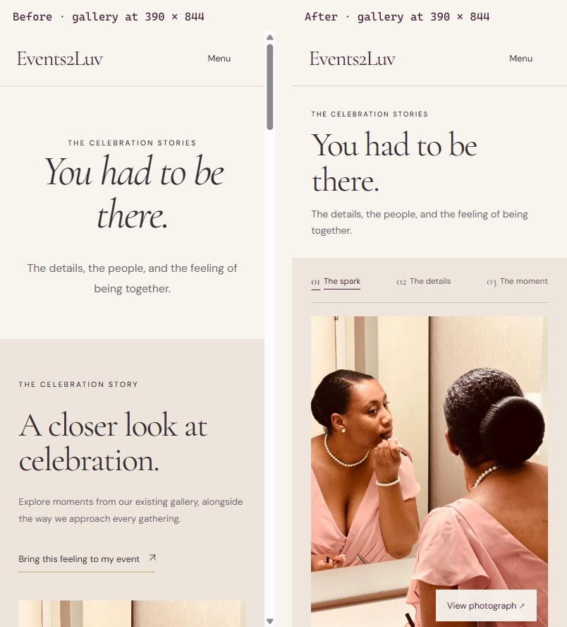

# Immersive story refinement

Review branch: `feat/immersive-story-refinement`, based on `391655b` from `feat/editorial-redesign`. The existing React/Vite application, Express/SQLite backend, content IDs, saved overrides, authentication, inquiries, upload validation and conflict handling remain in place. No production deployment or DNS changes.

## What changed

The homepage now moves from invitation to a three-part photographic sequence, then practical service summaries, Shaniese's introduction, the planning process and a final invitation. The gallery uses a preparation portrait, a landscape detail composition and a larger, uncropped couple photograph. The chapters represent a curated collection, not an invented single event.

The existing ivory `#F8F4EE`, plum `#4A253B`, champagne `#B79B67`, rose `#D7BAB4` and charcoal `#382E33` remain. Cormorant Garamond and DM Sans are now self-hosted through Fontsource. The composition alternates image and text positions; the page does not introduce another visual theme or an effects framework.

| Scene | Focal subject and purpose | Entry → settled state → exit |
| --- | --- | --- |
| Spark | Home: roses and crystals. Gallery: preparation at a mirror. Establish personal anticipation. | First image and caption already readable; hold before fading text out, then lifting the photo 24px. |
| Details | Home: reception setting. Gallery: place setting. Show how details create a setting. | Photo enters 32px below its resting position; caption appears only after outgoing text is gone; hold, then separate text/photo exits. |
| Moment | Couple and full dress/train. Put people at the center of the conclusion. | Larger portrait enters; text settles alongside it; hold and release naturally to the collection/services. |

One GSAP/ScrollTrigger timeline coordinates each major sequence. The pin advances over 2.4 viewport heights. Native scrolling, chapter anchors, history and reloads work together. Smaller/shorter viewports and reduced-motion users get normal flow, all chapters visible. Phones do not download GSAP. Edit mode reverts pinning and styles; Preview restores the visitor sequence. Oversized owner-written captions fall back to normal flow.

Removed the repeated floral inset and public photo montage. Their stored content remains accessible in All content, and the montage remains available in an admin-only archive with playback controls. The lower gallery adds the reception setting, cake and floral detail rather than repeating every chapter. The homepage service summary no longer repeats three gallery photographs.

Services explains what to include in an inquiry for each occasion without inventing packages, fees or inclusions. About adds a budget/priorities conversation and its own H1. The process now explains each step. Phone booking fields stack, preserve optional fields and flexible dates, and retain gallery/service inspiration and existing submission behavior. The final invitation explains the next step.

## Reproduced before fixing

- At 390 × 844, the first gallery photograph started at approximately **806px**. It now starts around **404px**.
- Narrow booking inputs measured **119–143px**. Text inputs now measure approximately **305px** at the same viewport.
- The old gallery transition exposed both scenes simultaneously: measured opacity **0.472 / 0.528** about 200ms into the transition, with both captions visible. The replacement removes outgoing text before revealing incoming text.
- Homepage services preceded the story; process steps were labels only; About had no H1; Services inherited the FAQ H1. These were confirmed in the original source and baseline browser.
- Browser testing also exposed and fixed lightbox focus restoration and initial chapter-fragment restoration after reload. Tablet review caught a preparation-photo crop cutting into a face; the tablet now preserves the portrait aspect ratio.

## Screenshots



Desktop gallery: [before](refinement/before-gallery-desktop.jpg), [old caption collision](refinement/before-caption-transition.jpg), [new Spark](refinement/after-gallery-desktop.jpg), [new Details](refinement/after-gallery-details.jpg), [new Moment](refinement/after-gallery-moment.jpg).

Homepage: [desktop](refinement/after-home-1440.jpg), [phone](refinement/after-home-390.jpg). [Phone booking form](refinement/after-booking-390.jpg).

These are actual browser captures. Chapter screenshots show settled states; motion was also exercised through scrolling and automated sampling.

## Verification

- `npm run build`: passed, production Vite build.
- Existing suite: **13 passed**, using Node 24 and FFmpeg in a disposable Docker container with `NODE_ENV=test` for the test runner. Integration tests create their own production-mode server and temporary database. Covers authorization, CSRF/origin, version conflicts, image/video uploads, corrupt uploads, inquiry storage, logout, persistence and media after restarts. Editor tests cover Save/Cancel/remount, shared links and failed-save retry.
- `npm run test:browser`: **5 passed** on headless Chrome 157. Tests sample captions across forward, fast and reverse progression; check chapter navigation/history/reload, viewport changes, reduced motion, animation-load failure, lightbox focus/Escape/restoration, phone menu, inquiry submission and admin persistence/Edit/Preview cycles. Browser inquiries and admin edits use a disposable database on port 4400 with SMTP disabled.
- Axe WCAG A/AA checks across six public pages at **390 × 844, 768 × 1024, 1440 × 900 and 1280 × 720**: **24 combinations, zero violations**, no horizontal overflow, one H1 per page, no page JavaScript errors. A shared footer-link contrast issue was corrected.
- Screenshots inspected at all four sizes, including image crops and form layout. Browser checks supplement, rather than establish, a full assistive-technology audit. No physical-device or screen-reader certification is claimed.
- Responsive WebP variants preserve aspect ratios and intrinsic dimensions. Uploaded replacements bypass the bundled-asset srcset map. Below-fold images stay lazy; the first gallery image and homepage hero have loading priority. The public site no longer loads the montage.

### Measured Lighthouse results

Lighthouse **13.6.0**, headless Chrome **157**, local Express server serving the production Vite build at `http://localhost:4401`, fresh disposable data, simulated throttling. Mobile: 412 × 823, DPR 1.75, 150ms RTT / 1.6Mbps / 4× CPU slowdown. Desktop: 1350 × 940, DPR 1, 40ms RTT / 10Mbps / 1× CPU. Single runs per route/mode; these are local lab measurements, not hosted or field results.

| Page / mode | Performance | Accessibility | Best practices | SEO | LCP | CLS | TBT |
| --- | ---: | ---: | ---: | ---: | ---: | ---: | ---: |
| Home / mobile | 79 | 100 | 100 | 100 | 4.3s | 0.020 | 300ms |
| Gallery / mobile | 86 | 100 | 100 | 100 | 3.8s | 0.045 | 160ms |
| Home / desktop | 98 | 100 | 100 | 100 | 1.1s | 0.017 | 0ms |
| Gallery / desktop | 100 | 100 | 100 | 100 | 0.8s | 0.001 | 0ms |

Mobile LCP remains the main performance limitation under the simulated slow connection. The local server serves assets without a CDN or transfer compression. Deployment performance should be measured on the eventual host. No target score is claimed.

Full local HTML/JSON reports and all viewport captures are in ignored `artifacts/refinement/`. Run `npm run audit:lighthouse` to reproduce the performance audit; it creates and shuts down its own isolated server.

## Run and review

The current refined preview is **http://localhost:3002/**, serving the production build from this checkout without stopping the pre-existing server on port 3000. Both instances returned identical saved-content JSON; the new preview had no browser console errors. Automatic approval review rejected restarting the old process with the generic reason “blocked by policy”; the separate production-build preview provides the refreshed content schema safely. It is local only, not a production deployment. Rebuild and restart this preview to pick up code changes.

Use Node **24.15+** and FFmpeg/FFprobe for the complete integration suite (the current Windows host is 24.13.1; the full suite was verified in the supported container).

```sh
cd recovered
npm ci
npm run dev
# http://localhost:3000

npm run build
npm test
npm run test:browser
npm run audit:browser
npm run audit:lighthouse
```

The browser scripts expect installed Google Chrome. `audit:browser` reads the running local preview by default; set `QA_ORIGIN` to audit another local instance. `test:browser` uses a dedicated temporary server/database and never writes into the owner's data directory. Restart the development server after changes to `src/content.js` so its server-side content schema is refreshed.

## Photography and content gaps

The eight suitable photographs were visually audited; Shaniese's genuine portrait is unchanged. The original hero is the strongest wide atmospheric image. The preparation and couple photographs support portraits; the place setting and floral images support details; the reception image supplies a setting, but there is no verified panoramic room reveal or matching detail-to-wide event sequence. The birthday cake is distinctive but comparatively low-resolution, so it stays in a modest frame. No unrelated stock or generated portfolio evidence was added.

The existing asset manifest still records unverified photographer rights and Events2Luv's exact role. No client names, venue credits, testimonials, budgets, service packages or outcomes were invented. More verified human moments and a cohesive event set would allow less cross-page reuse. Real email delivery, public hosting, business copy approval and production cutover remain separate from this refinement.
